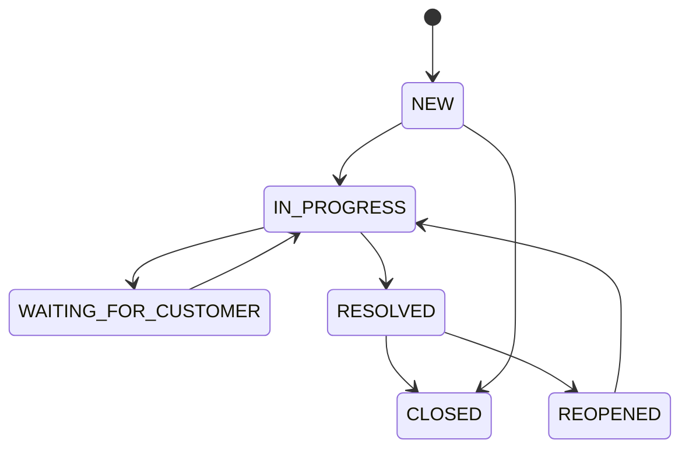

# SupportFlow

Консольная система обработки обращений в поддержку.

## Запуск

```bash
mvn package
java -jar target/supportflow-1.0.0.jar
```

Тесты: `mvn test` (JUnit 5).

## Слои

```
ui          ConsoleApp        ввод/вывод, перехват ошибок
service     TicketService     сценарии (интерфейс) + TicketServiceImpl
repository  *Repository       хранилище в памяти
model       Ticket и др.      сущности и правила (в т.ч. переходы статусов)
exception   *Exception        доменные ошибки
```

Зависимости идут сверху вниз: `ui -> service -> repository -> model`.
Правила переходов статусов живут в `TicketStatus`, а проверяет их `Ticket.changeStatus()`.

## Жизненный цикл обращения

```
NEW -> IN_PROGRESS -> WAITING_FOR_CUSTOMER -> RESOLVED -> CLOSED
 \________________________________________________/
                                  RESOLVED -> REOPENED -> IN_PROGRESS
```


